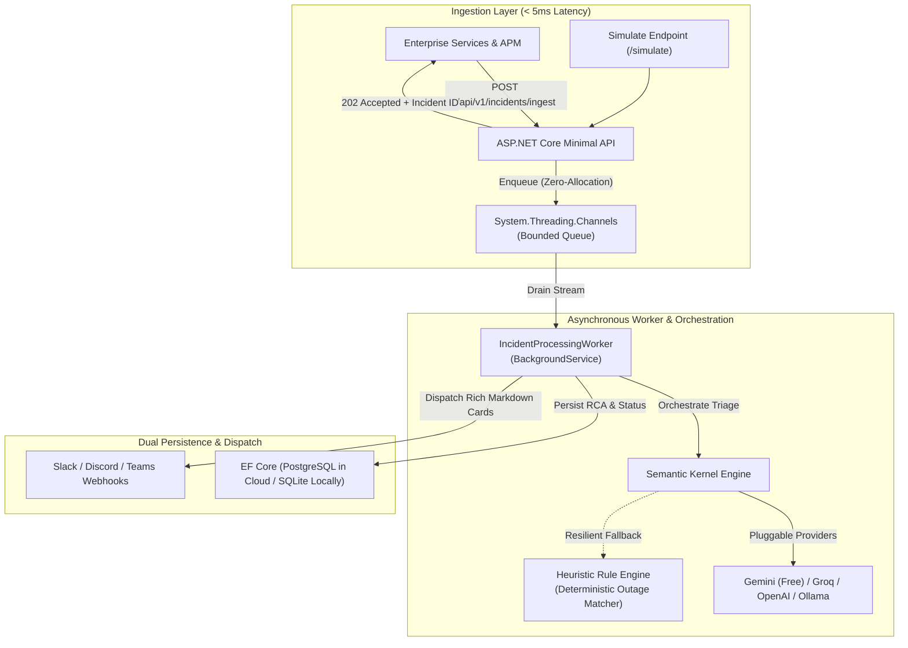

# OpsAI ⚡ 
### Enterprise AI Incident Triaging & Telemetry Engine

[](https://dotnet.microsoft.com/)
[](https://github.com/microsoft/semantic-kernel)
[](https://scalar.com)
[](https://www.npgsql.org/)
[](https://opensource.org/licenses/MIT)

**OpsAI** is a high-throughput, cloud-native telemetry ingestion and AI incident triaging engine engineered in modern C# / .NET. Built specifically to tackle enterprise site reliability engineering (SRE) and database operations bottlenecks across corporate sectors (energy, banking, logistics, and real estate).

OpsAI ingests unhandled exceptions, transaction deadlocks, downstream HTTP timeouts, and slow query traces in < 5ms, buffers them via lock-free producer-consumer channels, and orchestrates **Microsoft Semantic Kernel** to perform automated root cause analysis (RCA), assign enterprise severity classifications (P1–P4), generate concrete SQL index DDL, and dispatch actionable markdown alerts to Slack and Discord.

---

## Architecture Overview



---

## Key Enterprise Architectural Patterns

1. **Non-Blocking Ingestion (`System.Threading.Channels`):**
   - Telemetry ingestion endpoints cannot block on 2-5 second LLM calls during an incident storm. OpsAI pushes events into an in-memory, bounded `Channel<Incident>` and immediately returns `202 Accepted`.
   - An ASP.NET Core `BackgroundService` drains the channel with backpressure control, ensuring zero request thread pool exhaustion.

2. **Microsoft Semantic Kernel with Resilient Heuristics:**
   - Pluggable AI connectors support **Google Gemini API** (free tier: 15 RPM / 1M TPM), **Groq** (Llama 3.3 70B), **OpenAI**, and local **Ollama**.
   - If an LLM hits a rate limit (HTTP 429) or network timeout, the pipeline seamlessly falls back to a deterministic `HeuristicTriageEngine` that identifies connection pool exhaustion, deadlock victims, and missing indexes with regex and query analysis—guaranteeing **zero dropped incidents**.

3. **Database Architecture & Zero-Config Local Dev:**
   - **Local:** Runs out of the box using SQLite (`opsai.db`) with zero external container dependencies.
   - **Cloud:** Automatically switches to PostgreSQL (`Npgsql`) when a `PostgresConnection` connection string is supplied.
   - Built-in schema auto-creation and migrations on startup (`db.Database.EnsureCreatedAsync()`).

4. **Modern Developer Experience with Scalar:**
   - Uses **Scalar** (`Scalar.AspNetCore`) for clean, dark-mode interactive API documentation, interactive curl testing, and multi-language client snippet generation.

---

## Enterprise Simulation Scenarios (`/api/v1/simulate`)

OpsAI includes a built-in simulation test harness to demonstrate real-world failure triage on demand:

| Scenario | Simulated Incident | AI Diagnosis & Remediation |
|---|---|---|
| `pool_exhaustion` | PostgreSQL connection pool saturation during peak load (active threads exceed `Max Pool Size=100`). | **P1 Critical:** Identifies DB starvation, flags active thread leaks, recommends PgBouncer and `Max Pool Size=200` scaling. |
| `slow_query` | 8,420ms unindexed sequential scan across 2.4M rows in `billing_transactions`. | **P2 High:** Analyzes query predicate and outputs production-ready `CREATE INDEX CONCURRENTLY` DDL statement. |
| `deadlock` | Transaction deadlock victim (SQL Server 1205 / PostgreSQL 40P01) during inventory reservation. | **P2 High:** Identifies conflicting resource access order, outputs lock query diagnostics, and recommends retry policy. |
| `timeout` | Downstream microservice 504 gateway timeout after 15,000ms. | **P2 High:** Recommends Polly circuit breaker configuration and fallback caching. |

---

## Getting Started

### Prerequisites
* [.NET 10 SDK](https://dotnet.microsoft.com/download) (or Homebrew: `brew install dotnet`)

### Running Locally (Zero-Config SQLite)

```bash
git clone https://github.com/your-username/ops-ai.git
cd ops-ai

# Build the solution and run all unit + integration tests
dotnet test

# Run the API
dotnet run --project src/OpsAI.Api
```

Once running, navigate to:
* **Interactive Scalar UI:** [http://localhost:5000/scalar/v1](http://localhost:5000/scalar/v1) (or port displayed in terminal)
* **Health Check Probe:** [http://localhost:5000/healthz](http://localhost:5000/healthz)

---

## API Usage Examples

### 1. Ingest an Application Incident
```bash
curl -X POST http://localhost:5000/api/v1/incidents/ingest \
  -H "Content-Type: application/json" \
  -d '{
    "serviceName": "payments-settlement-svc",
    "environment": "Production",
    "type": "ConnectionPoolExhaustion",
    "title": "Timeout expired prior to obtaining connection from pool",
    "message": "System.InvalidOperationException: Timeout expired. All 100 pooled connections were in use.",
    "executionDurationMs": 30005.0
  }'
```

**Response (`202 Accepted`):**
```json
{
  "incidentId": "3fa85f64-5717-4562-b3fc-2c963f66afa6",
  "status": "Pending",
  "trackingUrl": "/api/v1/incidents/3fa85f64-5717-4562-b3fc-2c963f66afa6",
  "ingestedAt": "2026-10-11T16:40:00Z"
}
```

### 2. Trigger an Enterprise Failure Simulation
```bash
# Available scenarios: pool_exhaustion, slow_query, deadlock, timeout
curl -X POST "http://localhost:5000/api/v1/simulate?scenario=slow_query"
```

### 3. Fetch Triaged Diagnostics & SQL Fix
```bash
curl -X GET http://localhost:5000/api/v1/incidents/{incidentId}
```

**Response (`200 OK` with AI Triage):**
```json
{
  "id": "3fa85f64-5717-4562-b3fc-2c963f66afa6",
  "serviceName": "billing-ledger-svc",
  "status": "Triaged",
  "triage": {
    "severity": "P2_High",
    "rootCause": "Unindexed Sequential Scan: Query execution duration (8421ms) exceeded acceptable SLAs.",
    "impactScope": "Moderate to High: Elevated CPU and I/O pressure on the database server.",
    "remediationPlan": "1. Run EXPLAIN (ANALYZE, BUFFERS).\n2. Create a composite B-Tree index on filter and order predicates.",
    "suggestedSqlFix": "CREATE INDEX CONCURRENTLY IF NOT EXISTS idx_billing_transactions_lookup \nON billing_transactions (created_at DESC, status_id);",
    "aiModelUsed": "Gemini:gemini-2.0-flash",
    "triageDurationMs": 842.0
  }
}
```

---

## Configuring AI Providers & Webhooks

Set environment variables or edit `appsettings.json`:

```json
{
  "AI": {
    "Provider": "Gemini",
    "ModelId": "gemini-2.0-flash",
    "ApiKey": "YOUR_GEMINI_API_KEY"
  },
  "Webhooks": {
    "Enabled": true,
    "SlackWebhookUrl": "https://hooks.slack.com/services/...",
    "DiscordWebhookUrl": "https://discord.com/api/webhooks/..."
  }
}
```

* **Free Google Gemini API:** Get a free API key at [Google AI Studio](https://aistudio.google.com/).
* **Free Groq API:** Set `"Provider": "Groq"`, `"ModelId": "llama-3.3-70b-versatile"`, and provide your Groq API key.
* **Offline Local Mode:** Set `"Provider": "Ollama"`, `"ModelId": "llama3.2"`, and run `ollama run llama3.2`.
* **Zero-Config Default:** If no API key is set, OpsAI automatically operates using the built-in `HeuristicTriageEngine`.

---

## 100% Free Cloud Deployment Guide

### Option 1: Render Web Service (Free Tier)
1. Fork or push this repository to GitHub.
2. Create a free PostgreSQL instance on **[Neon Serverless](https://neon.tech)** (free 0.5 GB storage tier).
3. In **[Render](https://render.com)**, create a new **Web Service** connected to your repository:
   - **Environment:** Docker
   - **Dockerfile Path:** `./Dockerfile`
   - **Port:** `8080`
4. Add Environment Variables in Render:
   - `ConnectionStrings__PostgresConnection`: `Host=...;Database=...;Username=...;Password=...;SSL Mode=Require;Trust Server Certificate=true`
   - `AI__ApiKey`: Your free Gemini or Groq API key
   - `AI__Provider`: `Gemini`

---

## Solution Structure

```
ops-ai/
├── src/
│   ├── OpsAI.Core/              # Domain entities (Incident, TriageResult), enums, interfaces, FluentValidation
│   ├── OpsAI.Infrastructure/    # EF Core (Postgres/SQLite), Semantic Kernel, Channels, Heuristics, Webhooks
│   └── OpsAI.Api/               # ASP.NET Core Minimal APIs, Scalar UI, BackgroundService Worker, Simulator
├── tests/
│   └── OpsAI.Tests/             # Unit tests (heuristics, channels) & WebApplicationFactory integration tests
├── .github/workflows/ci.yml     # Automated GitHub Actions build and test pipeline
├── Dockerfile                   # Multi-stage hardened production Dockerfile
└── OpsAI.sln                    # Visual Studio / .NET Solution
```

---

## License

This project is licensed under the [MIT License](LICENSE).
