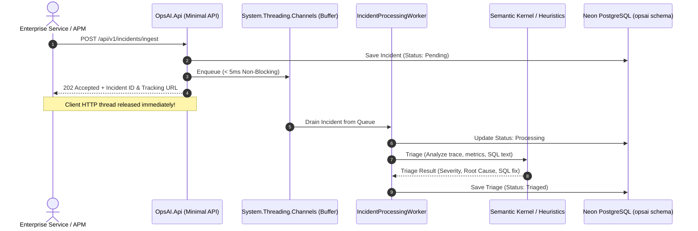

# OpsAI ⚡ 
### Enterprise AI Incident Triaging & Telemetry Engine

[](https://github.com/jeffreyehogg/ops-ai/actions)
[](https://ops-ai-aux2.onrender.com/scalar/v1)
[](https://dotnet.microsoft.com/)
[](https://github.com/microsoft/semantic-kernel)
[](https://ops-ai-aux2.onrender.com/scalar/v1)
[](https://neon.tech)
[](https://opensource.org/licenses/MIT)

**OpsAI** is a high-throughput, cloud-native telemetry ingestion and AI incident triaging engine engineered in modern **C# / .NET**. Built specifically to solve enterprise Site Reliability Engineering (SRE) and database operations bottlenecks across corporate sectors (energy, banking, logistics, and real estate).

OpsAI ingests unhandled exceptions, database transaction deadlocks, downstream HTTP timeouts, and slow query traces in **< 5ms**, buffers them via lock-free producer-consumer memory channels, and orchestrates **Microsoft Semantic Kernel** to perform automated root cause analysis (RCA), assign enterprise severity classifications (P1–P4), generate concrete SQL index DDL, and dispatch actionable alerts.

---

## 🌐 Live Cloud Deployment

The application is deployed live in production on **Render** (containerized via multi-stage Docker) connected to **Neon Serverless PostgreSQL**:

| Resource | URL | Description |
|---|---|---|
| **Interactive API Documentation** | **[https://ops-ai-aux2.onrender.com/scalar/v1](https://ops-ai-aux2.onrender.com/scalar/v1)** | Full dark-mode interactive testing UI (Scalar) |
| **Health Check Liveness Probe** | **[https://ops-ai-aux2.onrender.com/healthz](https://ops-ai-aux2.onrender.com/healthz)** | Production container health status (`200 OK`) |
| **OpenAPI 3.1.1 Specification** | **[https://ops-ai-aux2.onrender.com/openapi/v1.json](https://ops-ai-aux2.onrender.com/openapi/v1.json)** | Machine-readable API schema |

---

## The Problem: Alert Storms & Triage Fatigue

In large-scale enterprise environments, production outages trigger cascading failures. Within seconds, hundreds of error traces flood Slack and PagerDuty:
* **The War Room Bottleneck:** Senior engineers spend 30–60 minutes trying to identify if an error is a catastrophic P1 or a harmless P4 warning, which microservice caused it, and what SQL or code change mitigates it.
* **Why Naive AI Fails:** Synchronous AI calls take 1.5–5 seconds. If an app calls an LLM directly during an incoming error HTTP request, 100 simultaneous errors will instantly exhaust the web server's connection thread pool and cause a cascading 504 outage.
* **The OpsAI Solution:** OpsAI decouples ingestion from AI analysis using lock-free concurrency, evaluates telemetry asynchronously, persists findings to PostgreSQL, and provides concrete remediation steps before human triage even starts.

---

## Architecture & Data Flow



---

## Key Enterprise Architectural Patterns

### 1. High-Throughput Non-Blocking Ingestion (`System.Threading.Channels`)
* Telemetry endpoints (`POST /api/v1/incidents/ingest`) validate the payload via FluentValidation, insert the record in a `Pending` state, and enqueue the item to a bounded, lock-free **`System.Threading.Channels.Channel<Incident>`** in **< 5ms**, immediately returning `202 Accepted`.
* An ASP.NET Core **`BackgroundService` (Worker)** drains the queue with backpressure control, ensuring zero request thread pool exhaustion during incident storms.

### 2. Microsoft Semantic Kernel with Resilient Heuristic Fallback
* Pluggable AI connectors support **Google Gemini API** (free tier: `gemini-2.0-flash`), **Groq** (`llama-3.3-70b-versatile`), **OpenAI**, and local **Ollama**.
* **Zero Dropped Incidents:** If an external LLM hits an HTTP 429 rate limit or network timeout (or if running offline without an API key), the pipeline seamlessly falls back to a deterministic `HeuristicTriageEngine` that identifies connection pool exhaustion, deadlock victims, and missing indexes with pattern analysis.

### 3. Dual Database Strategy with PostgreSQL Schema Isolation
* **Local:** Zero-configuration SQLite (`opsai.db`).
* **Cloud:** PostgreSQL via `Npgsql` (compatible with Neon Serverless or Render free tiers).
* **Schema Segregation (`opsai` schema):** To enable sharing a single free Neon PostgreSQL database instance across multiple portfolio projects, OpsAI automatically creates and isolates all its tables into the `opsai` schema (`opsai.Incidents`, `opsai.TriageResults`), leaving other applications in `public.*` completely untouched.
* **Unix Millisecond Normalization:** `DateTimeOffset` values are converted to Unix milliseconds (`long`) to guarantee indexed `ORDER BY` query performance across both SQLite and PostgreSQL.

### 4. Reverse Proxy SSL & CORS Architecture
* Configured `ForwardedHeadersOptions` with `KnownIPNetworks.Clear()` so ASP.NET Core trusts `X-Forwarded-Proto: https` from Render / Cloudflare reverse proxies, preventing mixed-content blocking.
* Enabled permissive CORS (`AllowAnyOrigin`, `AllowAnyHeader`, `AllowAnyMethod`) so browser clients and Scalar documentation work out of the box.

---

## Enterprise Simulation Scenarios (`/api/v1/simulate`)

OpsAI includes a built-in simulation harness to test real-world failure triage on demand:

| Scenario | Simulated Incident | AI Diagnosis & Concrete Remediation |
|---|---|---|
| `pool_exhaustion` | PostgreSQL connection pool saturation (active threads exceed `Max Pool Size=100`). | **P1 Critical:** Identifies DB starvation, flags active thread leaks, recommends PgBouncer and `Max Pool Size=200` scaling. |
| `slow_query` | 8,420ms unindexed sequential scan across 2.4M rows in `billing_transactions`. | **P2 High:** Analyzes query predicate and outputs production-ready `CREATE INDEX CONCURRENTLY` DDL statement. |
| `deadlock` | Transaction deadlock victim (SQL Server 1205 / PostgreSQL 40P01) during inventory reservation. | **P2 High:** Identifies conflicting resource access order, outputs lock query diagnostics, and recommends retry policy. |
| `timeout` | Downstream microservice 504 gateway timeout after 15,000ms. | **P2 High:** Recommends Polly circuit breaker configuration and fallback caching. |

---

## Quick Start: Testing the Live Cloud API

### 1. In Your Browser
Navigate to **[https://ops-ai-aux2.onrender.com/scalar/v1](https://ops-ai-aux2.onrender.com/scalar/v1)**, select `POST /api/v1/simulate`, enter `slow_query` or `pool_exhaustion`, and click **Test Request**.

### 2. In Your Terminal (`curl`)

#### Trigger an Outage Simulation:
```bash
curl -X POST "https://ops-ai-aux2.onrender.com/api/v1/simulate?scenario=slow_query"
```

**Response (`202 Accepted` in < 20ms):**
```json
{
  "scenario": "slow_query",
  "incident": {
    "incidentId": "c7df6365-7808-4622-b6aa-3f774d0ab82c",
    "status": "Pending",
    "trackingUrl": "/api/v1/incidents/c7df6365-7808-4622-b6aa-3f774d0ab82c",
    "ingestedAt": "2026-10-11T21:02:48Z"
  }
}
```

#### Fetch the AI Triage Result from Neon PostgreSQL:
```bash
curl "https://ops-ai-aux2.onrender.com/api/v1/incidents?limit=1"
```

**Output:**
```json
[
  {
    "id": "c7df6365-7808-4622-b6aa-3f774d0ab82c",
    "serviceName": "billing-ledger-svc",
    "status": "Triaged",
    "triage": {
      "severity": "P2_High",
      "rootCause": "Unindexed Sequential Scan: Query execution duration (8420ms) exceeded acceptable SLAs.",
      "impactScope": "Moderate to High: Elevated CPU and I/O pressure on the database server, leading to thread starvation.",
      "remediationPlan": "1. Run EXPLAIN (ANALYZE, BUFFERS).\n2. Create a composite B-Tree index on filter and order predicates.",
      "suggestedSqlFix": "CREATE INDEX CONCURRENTLY IF NOT EXISTS idx_billing_transactions_lookup \nON billing_transactions (created_at DESC, status_id);",
      "triagedAt": "2026-10-11T21:02:48Z"
    }
  }
]
```

#### Ingest a Custom Telemetry Payload:
```bash
curl -X POST https://ops-ai-aux2.onrender.com/api/v1/incidents/ingest \
  -H "Content-Type: application/json" \
  -d '{
    "serviceName": "payments-settlement-svc",
    "environment": "Production",
    "type": "ConnectionPoolExhaustion",
    "title": "Timeout expired prior to obtaining connection from pool",
    "message": "System.InvalidOperationException: Timeout expired. All 100 pooled connections were in use.",
    "executionDurationMs": 30005.0
  }'
```

---

## Running Locally

### Prerequisites
* [.NET 10 SDK](https://dotnet.microsoft.com/download) (or Homebrew on macOS: `brew install dotnet`)

```bash
git clone https://github.com/jeffreyehogg/ops-ai.git
cd ops-ai

# Run all 13 unit and integration tests
dotnet test

# Start the API (runs locally with zero-config SQLite)
dotnet run --project src/OpsAI.Api
```

Once running locally:
* **Scalar UI:** [http://localhost:5000/scalar/v1](http://localhost:5000/scalar/v1)
* **Health Check:** [http://localhost:5000/healthz](http://localhost:5000/healthz)

---

## Configuration Options

Edit `appsettings.json` or pass environment variables:

```json
{
  "ConnectionStrings": {
    "SqliteConnection": "Data Source=opsai.db",
    "PostgresConnection": ""
  },
  "AI": {
    "Provider": "Gemini",
    "ModelId": "gemini-2.0-flash",
    "ApiKey": ""
  },
  "Webhooks": {
    "Enabled": true,
    "SlackWebhookUrl": "",
    "DiscordWebhookUrl": ""
  }
}
```

* **Free Google Gemini API:** Get a free API key at [Google AI Studio](https://aistudio.google.com/app/apikey).
* **Free Groq API:** Set `"Provider": "Groq"`, `"ModelId": "llama-3.3-70b-versatile"`.
* **Offline Local Mode:** Set `"Provider": "Ollama"`, `"ModelId": "llama3.2"`.
* **Zero-Config Default:** If no API key is set, OpsAI automatically operates using the built-in `HeuristicTriageEngine`.

---

## Solution Structure

```
ops-ai/
├── src/
│   ├── OpsAI.Core/              # Domain entities (Incident, TriageResult), enums, DTOs, FluentValidation
│   ├── OpsAI.Infrastructure/    # EF Core (Postgres/SQLite), Semantic Kernel, Channels, Heuristics, Webhooks
│   └── OpsAI.Api/               # ASP.NET Core Minimal APIs, Scalar UI, BackgroundService Worker, Simulator
├── tests/
│   └── OpsAI.Tests/             # Unit tests (heuristics, channels) & WebApplicationFactory integration tests
├── .github/workflows/ci.yml     # Automated GitHub Actions CI workflow
├── Dockerfile                   # Multi-stage hardened production Dockerfile
├── render.yaml                  # Render Blueprint Infrastructure-as-Code
└── OpsAI.sln                    # Visual Studio / .NET Solution
```

---

## License

This project is licensed under the [MIT License](LICENSE).
